# Sitemap — 创界山·活人认证

- **生成时间**：2026-11-07T18:57:37.921Z
- **平台**：Multi（Web 主屏 + 手机私牌端）
- **数据源**：Brief + Stories（6 个）+ 现有 web/ 实现 grounding
- **页面总数**：25（主屏 13 / 手机 12）
- **最大深度**：2 层
- **主导航**：主屏 6 视图 / 手机 4 TabBar
- **关键 Flow**：5 个（跨端）

> ⚠️ 假设性 IA：probe 0 真人数据。本图为用户选定的**目标多端架构**（Web 主屏 + 手机私牌端），非现状逐字映射。页面 status 标注「现状/缺口」，体验类结构待真人 playtest + 多端技术可行性验证。

---

## 端拆分原则

公共/共享状态→host 主屏（全桌看）；私密/个人操作→phone 手机（手牌/出题/签印/投票）。一次认证高潮跨端协作：手机私密出题→主屏公示→手机签印作证→主屏判定。

- **主屏（host / Web 共享屏）**：公共状态轨，全桌一起看。山道 / 席位 / 山议票数 / 认证公开判定 / 结算 / 日志 / 教学。
- **手机（phone / 每人私密端）**：私密手牌 / 出题 / 签印 / 投票 / 复议 / 旁观。解决热座「手牌全桌可见」的隐私问题，并让全桌同时操作（服务 story-5 名场面密度）。

## 主导航

### 主屏 host（Web，6 视图，状态驱动聚焦）
- 山道 — `/#board`（icon: map）
- 席位 — `/#seats`（icon: users）
- 山议 — `/#council`（icon: vote）
- 认证 — `/#cert`（icon: badge-check）
- 结算 — `/#settle`（icon: trophy）
- 日志 — `/#log`（icon: scroll-text）
- 另有主机控制 chrome `/#setup`（主题/人数/模式/存档）与教学 overlay `/#tutorial`，非导航目的地。

### 手机 phone（Mobile TabBar，4 项）
- 行动 — `/m/action`（icon: layers）
- 认证 — `/m/cert`（icon: badge-check）
- 山议 — `/m/council`（icon: vote）
- 我的 — `/m/me`（icon: user）
- 加入牌局 `/m/join` 为 TabBar 前的会话入口；渐进披露为个人 overlay。

## 站点树

### 主屏 host
```
/ (Web 主屏·共享屏)
├── /#board (山道版图) [public·existing]
├── /#seats (席位·活人席计分) [public·existing]
├── /#council (山议票数公示) [public·existing]
│   └── /#council/exile (放逐公示) [public·gap]
├── /#cert (认证面板·公开判定) [public·existing]
│   ├── /#cert/progress (签印门槛公示) [public·existing]
│   ├── /#cert/witness (认证证人席) [public·gap]
│   └── /#cert/appeal (复议公示) [public·gap]
├── /#settle (结算面板) [public·gap]
│   └── /#settle/rank (排名公示·距峰顶格数) [public·gap]
├── /#log (日志) [public·existing]
├── /#tutorial (首局教学页) [public·existing]
└── /#setup (牌局控制) [role-restricted·refactor]
```

### 手机 phone
```
/m (手机私牌端·每人一台)
├── /m/join (加入牌局) [public·gap]
├── /m/action (行动·手牌) [authenticated·refactor]
│   └── /m/action/trial (关隘试炼面板) [authenticated·gap]
├── /m/cert (认证操作) [authenticated·refactor]
│   ├── /m/cert/sign (签印面板) [authenticated·refactor]
│   ├── /m/cert/challenge (质疑出题屏) [authenticated·refactor]
│   ├── /m/cert/witness (作证操作) [authenticated·gap]
│   └── /m/cert/appeal (复议投票面板) [authenticated·gap]
├── /m/council (山议投票) [authenticated·refactor]
└── /m/me (我的状态) [authenticated·refactor]
    ├── /m/me/observer (旁观者面板) [authenticated·gap]
    └── /m/me/coach (规则渐进披露提示) [authenticated·gap]
```

### Mermaid 节点树（含跨端同步边）

```mermaid
flowchart TD
  subgraph HOST["Web 主屏 · 共享公开状态轨"]
    page_host_board["山道版图 /#board"]
    page_host_seats["席位·活人席计分 /#seats"]
    page_host_council["山议票数公示 /#council"]
    page_host_exile["放逐公示 /#council/exile"]
    page_host_cert["认证面板·公开判定 /#cert"]
    page_host_cert_progress["签印门槛公示 /#cert/progress"]
    page_host_cert_witness["认证证人席 /#cert/witness"]
    page_host_cert_appeal["复议公示 /#cert/appeal"]
    page_host_settle["结算面板 /#settle"]
    page_host_rank["排名公示·距峰顶格数 /#settle/rank"]
    page_host_log["日志 /#log"]
    page_host_tutorial["首局教学页 /#tutorial"]
    page_host_setup["牌局控制 /#setup"]
    page_host_council --> page_host_exile
    page_host_cert --> page_host_cert_progress
    page_host_cert --> page_host_cert_witness
    page_host_cert --> page_host_cert_appeal
    page_host_settle --> page_host_rank
  end
  subgraph PHONE["手机私牌端 · 每人私密"]
    page_phone_join["加入牌局 /m/join"]
    page_phone_action["行动·手牌 /m/action"]
    page_phone_trial["关隘试炼面板 /m/action/trial"]
    page_phone_cert["认证操作 /m/cert"]
    page_phone_sign["签印面板 /m/cert/sign"]
    page_phone_challenge["质疑出题屏 /m/cert/challenge"]
    page_phone_witness["作证操作 /m/cert/witness"]
    page_phone_appeal["复议投票面板 /m/cert/appeal"]
    page_phone_council["山议投票 /m/council"]
    page_phone_me["我的状态 /m/me"]
    page_phone_observer["旁观者面板 /m/me/observer"]
    page_phone_coach["规则渐进披露提示 /m/me/coach"]
    page_phone_action --> page_phone_trial
    page_phone_cert --> page_phone_sign
    page_phone_cert --> page_phone_challenge
    page_phone_cert --> page_phone_witness
    page_phone_cert --> page_phone_appeal
    page_phone_me --> page_phone_observer
    page_phone_me --> page_phone_coach
  end
  page_phone_join -. 加入会话 .-> page_host_setup
  page_phone_action -. 位置更新 .-> page_host_board
  page_phone_challenge -. 出题公示 .-> page_host_cert
  page_phone_sign -. 签印进度 .-> page_host_cert_progress
  page_phone_witness -. 作证公示 .-> page_host_cert_witness
  page_phone_council -. 票数汇总 .-> page_host_council
  page_phone_appeal -. 复议 tally .-> page_host_cert_appeal
```


## 页面清单

| ID | Route | 端 | Label | Purpose | Access | Status | 关联 Story |
| --- | --- | --- | --- | --- | --- | --- | --- |
| page-host-board | `/#board` | 主屏 | 山道版图 | 全桌共享的山道格 / 玩家位置 / 峰顶待认证标记，铺垫与登顶的公共视觉锚点 | public | existing | story-2, story-4 |
| page-host-seats | `/#seats` | 主屏 | 席位·活人席计分 | 玩家公开状态（身份/阵营/体力/资源/位置/活人席）+ 实时计分，谁领先一目了然 | public | existing | story-2, story-6 |
| page-host-council | `/#council` | 主屏 | 山议票数公示 | 山议匿名投票的公开票数 tally 与结算（不显示谁投谁） | public | existing | story-2, story-3 |
| page-host-exile | `/#council/exile` | 主屏 | 放逐公示 | 山议放逐结果的专门公示屏（当前仅落在日志，无独立公示） | public | gap | story-3 |
| page-host-cert | `/#cert` | 主屏 | 认证面板·公开判定 | 认证高潮的公共舞台：待认证者 / 题目公示 / 判定结果 / 主题认证题卡，全桌视线焦点 | public | existing | story-4, story-5 |
| page-host-cert-progress | `/#cert/progress` | 主屏 | 签印门槛公示 | 签印 got/need 进度 + 门槛 N 公示，让全桌看到认证还差几枚（密度张力来源） | public | existing | story-5 |
| page-host-cert-witness | `/#cert/witness` | 主屏 | 认证证人席 | 出局者作为证人的公开席位公示（当前无证人席角色） | public | gap | story-3 |
| page-host-cert-appeal | `/#cert/appeal` | 主屏 | 复议公示 | 第三方复议的投票 tally 与裁定公示（当前有申请复议但无第三方投票 UI） | public | gap | story-3, story-5 |
| page-host-settle | `/#settle` | 主屏 | 结算面板 | 终局结算的专门视图（当前仅状态栏一个结束 badge，无完整结算屏） | public | gap | story-6 |
| page-host-rank | `/#settle/rank` | 主屏 | 排名公示·距峰顶格数 | 排名 / 活人席权重 / 距峰顶格数公示 + 胜者高亮，保障「名场面即胜利」可读 | public | gap | story-6 |
| page-host-log | `/#log` | 主屏 | 日志 | 公开事件 feed（最近 40 条），铺垫期桌上一直有动静 | public | existing | story-2 |
| page-host-tutorial | `/#tutorial` | 主屏 | 首局教学页 | 5 回合迷你流程演示弹窗，走真实引擎，3 分钟看懂一局（价值前置） | public | existing | story-1 |
| page-host-setup | `/#setup` | 主屏 | 牌局控制 | 主机操作者控制：主题/人数/模式/新开/存档/读档/导出/导入/教学；多端下「操作者席切换」改为房间会话 | role-restricted | refactor | story-1 |
| page-phone-join | `/m/join` | 手机 | 加入牌局 | 手机扫码 / 房间码加入主屏会话并绑定座位（多端新增入口） | public | gap | story-1 |
| page-phone-action | `/m/action` | 手机 | 行动·手牌 | 个人私密手牌 + 行棋/问天/行事/发动被动/对峙亮牌/选目标（热座公开手牌→手机私密） | authenticated | refactor | story-2 |
| page-phone-trial | `/m/action/trial` | 手机 | 关隘试炼面板 | 落到关隘格时的试炼选择 Modal，并在首道关隘预热「认证」概念（当前有 gate 格无试炼 UI） | authenticated | gap | story-2, story-1 |
| page-phone-cert | `/m/cert` | 手机 | 认证操作 | 个人认证操作入口：签印 / 质疑 / 弃权 / 判定（三选一），与主屏公开判定同步 | authenticated | refactor | story-4, story-5 |
| page-phone-sign | `/m/cert/sign` | 手机 | 签印面板 | 个人签印按钮 + 进度，降门槛后每人都有参与理由（密度） | authenticated | refactor | story-4, story-5 |
| page-phone-challenge | `/m/cert/challenge` | 手机 | 质疑出题屏 | 私密出 3 道「当场可验证」题并提交（热座公开出题→手机私密，制造惊喜） | authenticated | refactor | story-4, story-5 |
| page-phone-witness | `/m/cert/witness` | 手机 | 作证操作 | 出局者以证人身份参与作证（当前无此角色） | authenticated | gap | story-3 |
| page-phone-appeal | `/m/cert/appeal` | 手机 | 复议投票面板 | 第三方复议投票（当前有申请复议但无第三方投票端） | authenticated | gap | story-3, story-5 |
| page-phone-council | `/m/council` | 手机 | 山议投票 | 个人匿名投票（票数汇总到主屏公示，投票人不可见） | authenticated | refactor | story-2, story-3 |
| page-phone-me | `/m/me` | 手机 | 我的状态 | 我的身份/资源/位置/活人席/状态（个人视角，非全桌公开操作者切换） | authenticated | refactor | story-3 |
| page-phone-observer | `/m/me/observer` | 手机 | 旁观者面板 | 出局后的参与兜底：作证/复议/围观判定，人还在局里（当前出局即无动作） | authenticated | gap | story-3 |
| page-phone-coach | `/m/me/coach` | 手机 | 规则渐进披露提示 | 个人 coachmark / 渐进披露，边玩边学而非先啃规则书（当前仅一次性教学弹窗） | authenticated | gap | story-1 |

## 关键 Flow（跨端）

### 开局加入 Setup & Join
- **旅程锚点**：stage1 开场 ｜ **关联 Story**：story-1

主屏:牌局控制 → 主屏:首局教学页 → 手机:加入牌局 → 手机:我的状态

### 爬山铺垫 Climb
- **旅程锚点**：stage2 流失风险① ｜ **关联 Story**：story-2

手机:行动·手牌 → 主屏:山道版图 → 手机:关隘试炼面板 → 主屏:席位·活人席计分

### 山议放逐 Council & Exile
- **旅程锚点**：stage2 出局 ｜ **关联 Story**：story-3, story-2

主屏:山议票数公示 → 手机:山议投票 → 主屏:放逐公示 → 手机:旁观者面板

### 登顶认证高潮 Certification Climax
- **旅程锚点**：stage4 满意峰值 ｜ **关联 Story**：story-4, story-5, story-3

主屏:山道版图 → 主屏:认证面板·公开判定 → 手机:质疑出题屏 → 手机:签印面板 → 手机:作证操作 → 主屏:签印门槛公示 → 手机:复议投票面板 → 主屏:复议公示

### 终局结算 Settlement
- **旅程锚点**：stage5 流失风险② ｜ **关联 Story**：story-6

主屏:结算面板 → 主屏:排名公示·距峰顶格数 → 主屏:席位·活人席计分


## 现状 vs 缺口（调优工作量地图）

- **existing（已有，7）**：山道版图 / 席位·活人席计分 / 山议票数公示 / 认证面板·公开判定 / 签印门槛公示 / 日志 / 首局教学页
- **refactor（需多端拆分迁移，7）**：牌局控制 / 行动·手牌 / 认证操作 / 签印面板 / 质疑出题屏 / 山议投票 / 我的状态
- **gap（故事要求但当前缺失，11）**：放逐公示 / 认证证人席 / 复议公示 / 结算面板 / 排名公示·距峰顶格数 / 加入牌局 / 关隘试炼面板 / 作证操作 / 复议投票面板 / 旁观者面板 / 规则渐进披露提示

## 多端同步说明（新增技术需求）

⚠️ 多端实时同步层为新增需求（当前单文件离线、无外部请求）：host 持权威引擎状态广播→phone，phone 操作→host 结算。须保留现有引擎与九道门禁，仅拆分 UI。同步为局域网实时（非线上异步，符合 brief out_of_scope「不做线上异步验活人」）。技术可行性（WebSocket/WebRTC/本地房间服务）待验证。

**新增基础设施**：房间会话 / 扫码加入 (page-phone-join)；host↔phone 实时同步层；结算面板/排名公示 (当前仅 badge)；放逐公示；认证证人席/作证；复议第三方投票；旁观者面板；关隘试炼面板；规则渐进披露。

## 19 触点屏覆盖

- 山道版图 → 山道版图
- 关隘试炼面板 → 关隘试炼面板
- 山议投票面板 → 山议投票 / 山议票数公示
- 数字轨状态屏 → 席位·活人席计分
- 认证面板 → 认证面板·公开判定 / 认证操作
- 质疑出题屏 → 质疑出题屏
- 签印面板 → 签印面板
- 峰顶待认证标记 → 山道版图
- 结算面板 → 结算面板
- 活人席计分 → 席位·活人席计分
- 排名公示 → 排名公示·距峰顶格数
- 距峰顶格数 → 排名公示·距峰顶格数
- 首局教学页 → 首局教学页
- 规则渐进披露提示 → 规则渐进披露提示
- 放逐公示 → 放逐公示
- 认证证人席 → 认证证人席 / 作证操作
- 复议投票面板 → 复议投票面板 / 复议公示
- 签印门槛公示 → 签印门槛公示
- 复议面板 → 复议投票面板 / 复议公示

---

*Generated by product-design sitemap skill · platform=multi · 25 pages · 5 cross-device flows · 假设性，待验证*
